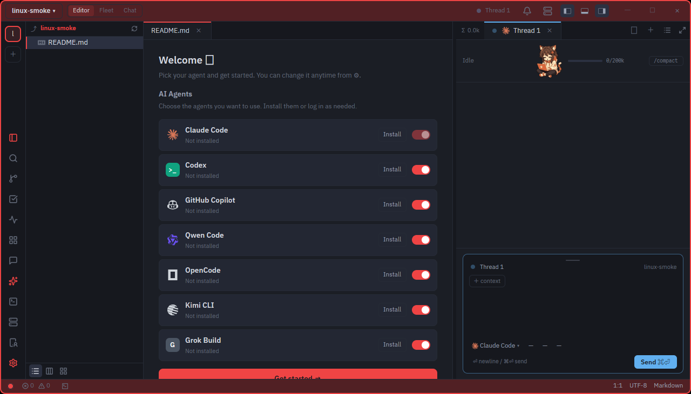
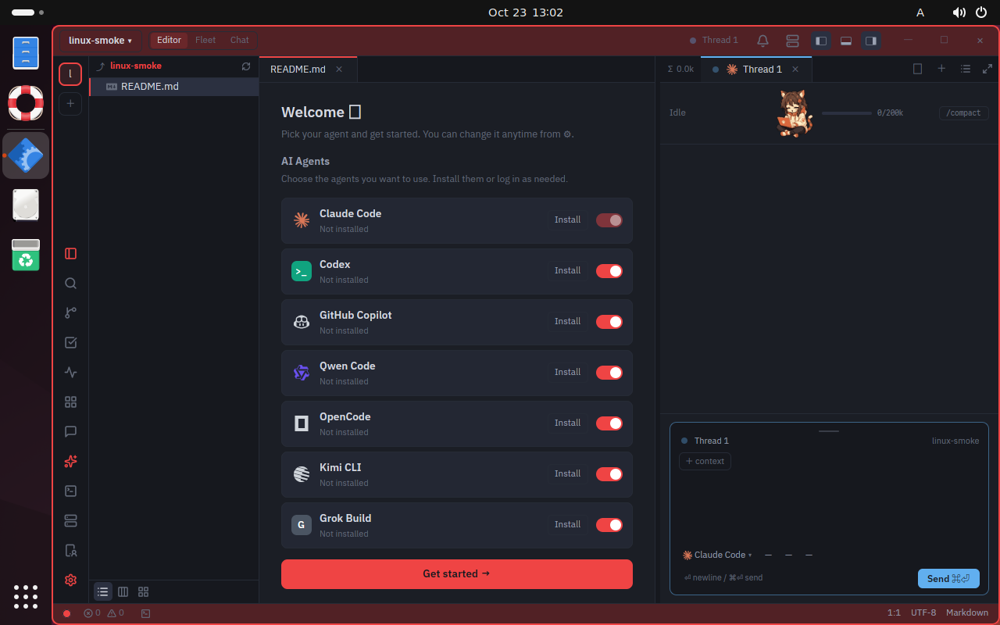

# Ubuntu Desktop 対応 — 計画と検証記録

開始: 2026-10-23。Linux Desktop 対応の現在地・手順・受入条件はこの文書を正とする。
Windows 対応は [WINDOWS-PORT.md](WINDOWS-PORT.md)、全体の予定は [ROADMAP.md](ROADMAP.md)。

**現在地（2026-10-23）: L0〜L2 の ARM64 Docker 検証は完了。Linux の実行ファイルを作成でき、
workspace テストは成功。L3 は UTM の Ubuntu ARM64 VM を作成・起動し、Desktop を導入中。
まだ GUI 受入完了・Linux 正式対応・配布済みではない。**

## 1. 方針と対象

まず Mac 上の Docker で Ubuntu 向けのビルドと画面を使わないテストを通す。
次に Ubuntu Desktop の仮想マシンで GUI を検証し、最後に実機で操作感を確認する。
**コンパイル成功・ヘッドレステスト成功を、GUI 動作確認済みとは扱わない。**

- 初回の基準環境: Ubuntu 24.04 LTS / ARM64（Apple Silicon 上の OrbStack）。
- AMD64 は別の検証対象。ARM64 の成功だけで AMD64 も対応済みとはしない。
- GPUI の固定 revision は更新しない。macOS / Windows の既存動作を保持する。
- Linux では Wayland / X11 の両方をビルド対象にする。
- 初期段階ではネイティブ WebView を追加しない。HTML / PDF / Web タブ・Design Mode の
  内蔵表示は別工程。外部ブラウザへの導線は GUI 検証時に確認する。
- 配布・公開・リリース作成は、ビルド確認とは別工程。

## 2. 工程と受入条件

| 工程 | 状態 | 完了の条件 |
|---|---|---|
| L0 再現可能な環境 | 完了 | Dockerfile・実行スクリプト・手順があり、ホストの target と分離できる |
| L1 Linux ビルド | ARM64 完了 | Wayland / X11 有効の `cargo check` と実行ファイルのリンクが成功 |
| L2 ヘッドレステスト | ARM64 完了 | Linux 上の workspace テストを実行し、失敗・skip を説明できる |
| L3 Desktop VM | 進行中 | ウィンドウ表示、編集・保存、IME、clipboard、terminal、AI 接続を操作確認 |
| L4 実機・AMD64 | 未着手 | AMD64 ビルド・テストと、実 GPU / HiDPI / 長時間利用の確認 |
| L5 配布 | 未着手 | パッケージ、desktop entry、CLI 設置、更新案内、必須 CI、配布手順 |
| L6 内蔵 WebView | 未着手 | GTK / WebKitGTK と GPUI の統合方式を決定し、対応画面で受入確認 |

### L3 の操作チェック（VM を用意してから）

- [ ] 起動・終了・再起動、プロジェクトを開く、hot exit の復元
- [ ] 日本語入力の変換中表示・候補位置・確定、コピー＆ペースト
- [ ] ファイルの編集・保存・検索・監視、Git の差分
- [ ] 統合ターミナルの起動・入力・リサイズ・子プロセス終了
- [ ] AI エージェントの検出・起動・応答・承認
- [ ] Wayland と X11 の描画、画面倍率、タイトルバー操作
- [ ] ファイル選択・外部 URL・通知、CLI の設置・既存ウィンドウへの転送
- [ ] 非対応の Web / PDF 機能が誤って利用可能と表示されない

**2026-10-23 の部分確認（Wayland + llvmpipe・素の `~/necoder`）** — 受入のチェックは付けない:

- [x] 起動・プロジェクトを開く
- [x] README の編集・保存（`Ctrl+S`）
- [x] `Ctrl+J` のターミナル起動・`/bin/echo` の実行
- [x] Wayland のクリップボード（`wl-copy`）から日本語を貼り付け
- [ ] IME の変換中表示・候補位置・確定 / 検索・監視 / Git / リサイズ / AI / 通知 / CLI / hot exit

## 3. 着手時の調査

- `paths`: Linux の XDG 保存先と runtime socket は実装・単体テストあり。
- `keymap_core`: Linux は Ctrl 系のキーマップを使用。OS ショートカット表もある。
- `gpui_platform`: 固定 revision は Linux 描画を持つが、アプリから `wayland` / `x11`
  が有効化されていなかった。`cargo check` だけでは起動時の不足を発見できない。
- `.github/workflows/ci.yml`: `check-linux` は `continue-on-error: true`、型検査のみ。
  今回 Ubuntu 24.04 に固定し、共通の依存導入・全ターゲット型検査・本体のリンク・workspace テストを追加。
  **変更後の GitHub Actions / AMD64 は未実行**のため、まだ必須ジョブにはしない。
- `webview_view`: Linux は明示的に対象外。単に wry の対象 OS を増やして済む変更ではない。
- `workspace::updater`: Linux は配布物がないため更新経路なし。
- `cli_shim`: Unix 向け設置先は `/usr/local/bin`。権限不足時の GUI 昇格は macOS のみ。
- Docker の実環境: OrbStack / Linux aarch64、メモリ約 16 GiB。ビルド並列数は控えめにする。
- 作業開始時点で他作業の未コミット変更あり。既存差分を保持し、検証対象はそれを含む作業ツリー。

## 4. 実行手順

### Mac / Docker での検証

Docker（この環境では既存の OrbStack）を起動して、リポジトリのルートで実行する。

```sh
bash scripts/test-linux-docker.sh check # workspace・テスト・example の型検査
bash scripts/test-linux-docker.sh build # necoder 実行ファイルをリンク
bash scripts/test-linux-docker.sh test  # 画面を使わない workspace テスト
# 上の 3 段階を順番に実行する場合
bash scripts/test-linux-docker.sh all
```

- イメージ: `scripts/linux/Dockerfile`（Ubuntu 24.04）。Rust は `rust-toolchain.toml` から読む。
- OS 依存: `scripts/linux/install-deps.sh`。Linux CI も同じファイルを使う。
- ホストのソースは `/workspace` に読み取り専用でマウント。未コミット変更も検証対象。
- Linux の成果物は `/build`（専用 named volume）。ホストの macOS 用 `target` は再利用しない。
- Cargo の registry / git キャッシュも専用 volume。ホストの HOME・SSH 鍵・認証設定は共有しない。
- ログはホストの `target/linux-port/<UTC日時>-<CPU>-<工程>.log`。終了コードを保って保存する。
- CPU は Docker エンジンと同じものを既定にする。`NECODER_LINUX_PLATFORM=linux/amd64` で
  AMD64 に変更できるが、ARM64 上ではエミュレーションになり、遅くなることがある。
- `NECODER_LINUX_JOBS=4` / `NECODER_LINUX_TEST_THREADS=2` が既定。メモリ不足なら減らす。
- 実行するコンテナは終了時に削除し、キャッシュは残す。volume 名は
  `necoder-linux-ubuntu24-<arm64|amd64>-{target,registry,git}`。
- 調査用の対話シェル: `bash scripts/test-linux-docker.sh shell`。その中の `/build/debug/necoder`
  がビルド成果物。**Docker 内には画面サーバを置かないので、ここでの GUI 起動は受入対象外。**
- `--locked` で lockfile の意図しない変更を止める。依存変更時はホスト側で Cargo.lock を更新してから再実行。

### Ubuntu Desktop VM での検証（L3・進行中）

この Mac では UTM 5.0.7 を Homebrew から導入し、次の VM を作成した。

- 名前: `necoder Ubuntu 24.04 ARM64`。UUID: `D92EFF4F-2033-4080-84CA-774A0D78793B`。
- ARM64 / QEMU + 仮想化 / 4 CPU / RAM 8 GiB / 64 GiB sparse disk。
- UTM の OpenGL アクセラレーションを有効化。共有ネットワークを使用。
- VM 本体: `~/Library/Containers/com.utmapp.UTM/Data/Documents/necoder Ubuntu 24.04 ARM64.utm`。
- ホストのディレクトリ共有は設定しない。検証専用ユーザー `necoder` と専用 SSH 鍵を使う。
- Ubuntu の公式 cloud image を基に、cloud-init で `ubuntu-desktop-minimal`、Mozc、
  Noto CJK、Vulkan tools、guest agent を導入する。Desktop ISO の手動インストールとは別の経路。

取り込み元ディスクと初期設定の再現手順:

```sh
bash scripts/prepare-ubuntu-vm.sh
```

公式 SHA256SUMS でダウンロードを検証し、`target/linux-vm/ubuntu-desktop.qcow2` と
`seed.iso` を生成する。UTM の新規作成 → 仮想化 → Linux → 既存ディスクを読み込む、で
前者を選び、初回起動前に後者も読み取り専用ドライブとして追加する。
seed は VirtIO のディスクとして取り込んでも NoCloud が認識することを実起動で確認した。
スクリプト再実行は既存ディスク・seed を上書きしない。設定変更は既存ゲストに自動反映されない。

`target/linux-vm/` は Git 対象外で mode 700。SSH 秘密鍵・ランダムなローカルログイン用パスワード・
初期設定が入るため、公開・共有しない。ゲストは検証専用で自動ログインと passwordless sudo を設定する。
実データやホストの認証情報は持ち込まない。

起動後の接続と導入状況（IP は再取得する）:

```sh
utmctl ip-address 'necoder Ubuntu 24.04 ARM64'
ssh -i target/linux-vm/ssh-key \
  -o UserKnownHostsFile=target/linux-vm/known_hosts \
  -o StrictHostKeyChecking=accept-new necoder@<上で取得したIPv4>
# 以下はゲスト内
cloud-init status
tail /var/log/necoder-desktop-setup.log
test -f /var/lib/necoder-desktop-ready
```

初回は Desktop パッケージの取得に時間がかかる。CLI ログイン画面の表示だけでは完了ではない。
準備ログ: `target/linux-port/vm-prepare.log`。ゲスト内セットアップログには秘密鍵を含めない。

Mac 内の仮想マシンに Ubuntu Desktop をインストールする。Apple Silicon なら ARM64、
Intel / AMD のマシンなら AMD64 が基本。Docker のコンテナに Desktop を追加する手順ではない。
初回ビルドの割当目安は RAM 8 GiB 以上（余裕があれば 12〜16 GiB）と空きディスク 60 GiB 以上。
これは性能の保証値ではなく、依存のコンパイルと成果物のための目安。

VM 内にソースを clone し、rustup を導入して、Ubuntu のデスクトップ内のターミナルから実行する。

```sh
sudo bash scripts/linux/install-deps.sh
cargo run --locked -p necoder
```

Linux の Wayland / X11 は target 依存で有効になるため、追加の `--features` は不要。
VM の仮想 GPU が GPUI の必要機能を提供するかは未検証だったが、2026-10-23 に VM で
黒画面の切り分けを行った（次節）。起動失敗時には、OS・CPU・Wayland/X11・GPU/ドライバ・
stderr を記録する。CPU 描画で起動しても性能確認とは区別する。

### 描画が黒い問題（2026-10-23・VM の Virtio-GPU Venus）

> 既存の資料には「VM の仮想 GPU が GPUI の必要機能を提供するかは未検証」としか書かれていなかった。
> この切り分けは 2026-10-23 に新たに行ったもので、上流 GPUI の `main` も同じコードのまま
> （未修正）であることを確認している。

VM の Ubuntu Desktop（UTM / ARM64 / `virtio-gpu-gl-pci`・`venus=true`）で、necoder の窓は
マップされるがクライアント領域が黒/透明のままだった。切り分けの結果:

- `glxgears`（GLX）と `vkcube`（Vulkan/Venus）は同じ Xorg で正常に描画する。GPU そのものは動く。
- necoder の `Workspace::render` は呼ばれている（`NECODER_WGPU_LOG=1` の診断ロガー）。
- wgpu のサーフェスは 1280×731 / `Bgra8Unorm` / `alpha_mode: Inherit`。X11 の visual は
  GPUI が 32-bit ARGB（`visual_set.transparent`）を選ぶ。
- llvmpipe / GL だけでは `No GPU adapter found that can configure the display surface`。
- GPUI の X11 visual 選択を **24-bit opaque** に変えると、**llvmpipe + Vulkan** で
  UI が完全に描画された（下の画像）。同じ 24-bit opaque でも **Venus は黒いまま**。



Wayland（Ubuntu 24.04 の既定）でも確認した。**Venus では窓が不可視**（デスクトップだけが見える）。
**llvmpipe では Wayland でも UI が完全に描画**される（下の画像）。これは**素の `~/necoder`
（一時パッチなし）**でも同じで、Wayland は visual パッチ不要。Wayland の経路自体は正常で、
VM の Venus が X11 / Wayland の両方で描画できない、という整理になる。

Wayland + llvmpipe で L3 の一部も確認した（素の `~/necoder`）。README を開いて編集・保存
（`Ctrl+S`）、`Ctrl+J` でターミナル起動、`/bin/echo` の実行、`wl-copy` の日本語を `Ctrl+V` で
貼り付けまで動いた。`echo` は command-not-found になった（`/bin/echo` は動く）ので、
シェル / PATH は要確認。IME 変換・検索・監視・Git・リサイズ・AI・通知・CLI・hot exit は未確認。



**原因は2層**:

1. **VM の Virtio-GPU Venus + wgpu** の組み合わせ（X11 / Wayland の両方で不可視）。実機の GPU では起きにくいが、未確認。
2. **GPUI の X11 が opaque な窓でも 32-bit transparent visual を無条件に選ぶ**こと。
   llvmpipe / GL の surface 構成を壊し、alpha も `Inherit` になりやすい。上流 `main` の
   `crates/gpui_linux/src/linux/x11/window.rs` も同じ（2026-10-23 時点・未修正）。

**VM での暫定回避（機能確認用）**:

- `VK_ICD_FILENAMES=/usr/share/vulkan/icd.d/lvp_icd.json`（llvmpipe）で起動する。
- GPUI の `x11/window.rs` の visual 選択を 24-bit opaque にする一時パッチを当てる。
- **llvmpipe はソフトウェア描画**。起動・描画の機能確認には使えるが、性能の確認には使わない。

**未確認 / 次**:

- 実機（Intel / AMD / NVIDIA）の X11 / Wayland。最低限、Ubuntu 24.04 の既定 **Wayland を1台**。
- VM の Wayland は llvmpipe で描画確認済み。Venus では Wayland でも窓が不可視（X11 の visual パッチでは直らない）。
- 上流 GPUI へ issue / PR。opaque 窓は opaque visual、または transparent で surface 構成に
  失敗したら opaque で retry する。
- **L3 の「Wayland と X11 の描画」は未完了のまま**（チェックを付けない）。

診断ログの出し方（`NECODER_WGPU_LOG=1` の診断ロガー）:

```sh
NECODER_WGPU_LOG=1 ./target/debug/necoder 2> /tmp/necoder-wgpu.log
grep -E "Using Visual|Selected GPU|configuring surface|No GPU" /tmp/necoder-wgpu.log
```

## 5. 検証記録

| 日付 | 環境 / コマンド | 結果・観測 |
|---|---|---|
| 2026-10-23 | `docker info` | OrbStack の ARM64 Linux エンジンを利用可能。GUI は未検証 |
| 2026-10-23 | macOS: `cargo check --offline -p necoder` | 成功。Linux の target 依存追加後も macOS はビルド可能 |
| 2026-10-23 | macOS: `cargo test --locked --offline -p necoder` | 24 件成功（本体 21 + 統合 3）、失敗なし |
| 2026-10-23 | `cargo deny check`（初回） | X11 入力の xim-rs git source が未許可で失敗。固定 rev の 3 crate の MIT 表記を確認し、deny.toml と THIRD_PARTY_NOTICES.md に追記。既存依存の版は上げない |
| 2026-10-23 | Ubuntu 24.04 ARM64: `bash scripts/test-linux-docker.sh check` | **成功・警告なし**。`cargo check --locked --workspace --all-targets`、Cargo の所要時間 1m49s（イメージ構築を除く）。ログ: `target/linux-port/20261023T065158Z-arm64-check.log` |
| 2026-10-23 | `CARGO_NET_OFFLINE=true bash scripts/check-license-boundary.sh` | 成功。既存の GPL/AGPL 境界から追加逸脱なし |
| 2026-10-23 | `cargo deny --offline check`（修正後） | 成功。advisories / bans / licenses / sources の全項目通過。既存の cfg_block ライセンス表記・yanked 依存の警告は残る。ログ: `target/linux-port/dependency-audit.log` |
| 2026-10-23 | Ubuntu 24.04 ARM64: `bash scripts/test-linux-docker.sh build` | **成功・警告なし**。`cargo build --locked -p necoder --bin necoder`、1m24s。ログ: `target/linux-port/20261023T065542Z-arm64-build.log` |
| 2026-10-23 | `bash -n`（追加した 2 スクリプト）、actionlint 1.7.12（ci.yml） | 成功 |
| 2026-10-23 | Ubuntu 24.04 ARM64: `bash scripts/test-linux-docker.sh test`（初回） | workspace の Web / PDF テスト 7 件で失敗。他 OS のネイティブビューを前提にした期待値が原因。ログ: `target/linux-port/20261023T065726Z-arm64-test.log` |
| 2026-10-23 | Ubuntu 24.04 ARM64: `bash scripts/test-linux-docker.sh test`（修正後） | **成功**。Rust の集計: 1,178 passed / 0 failed / 12 ignored（doc-test を含む）。PTY の実シェル入出力も成功。ログ: `target/linux-port/20261023T070142Z-arm64-test.log` |
| 2026-10-23 | Ubuntu 24.04 ARM64: `bash scripts/test-linux-docker.sh check`（最終） | **成功・警告なし**。テスト用 accessor の OS 条件を整えて未使用警告も解消。ログ: `target/linux-port/20261023T070337Z-arm64-check.log` |
| 2026-10-23 | macOS: `cargo test --locked --offline -p workspace --lib` | **302 passed / 0 failed / 1 ignored**。macOS の内蔵 Web / PDF の既存成功系を維持。ログ: `target/linux-port/macos-workspace-test.log` |
| 2026-10-23 | Ubuntu: `file /build/debug/necoder` / `ldd /build/debug/necoder` | ARM64 Linux ELF、共有ライブラリの `not found` なし。GUI 起動はしていない。ログ: `target/linux-port/binary-inspection.log` |
| 2026-10-23 | Ubuntu ARM64 VM: virtio-gpu Venus / llvmpipe + GPUI 24-bit visual | X11 の窓は黒（Venus）。llvmpipe + 24-bit opaque visual で UI 全体を描画確認（`images/linux-vm-llvmpipe-2026-10-23.png`）。GL は surface 構成不可 |
| 2026-10-23 | Ubuntu ARM64 VM: Wayland + llvmpipe / Venus | 素の `~/necoder` で Wayland + llvmpipe の UI 全体を描画確認（`images/linux-vm-wayland-llvmpipe-2026-10-23.png`）。Venus は Wayland でも不可視。Wayland は visual パッチ不要 |
| 2026-10-23 | Ubuntu ARM64 VM: Wayland + llvmpipe で L3 部分確認 | README の編集・保存、`Ctrl+J` のターミナル、`/bin/echo`、`wl-copy` の日本語貼り付け。`echo` は command-not-found（`/bin/echo` は動く）。IME・検索・Git・AI ほかは未確認 |

### テスト成功の範囲

- `#[ignore]` の 12 件は既存の分類のまま: 実エージェント・認証・ネットワーク 7 件、
  性能計測 2 件、実 rust-analyzer 2 件、ログインシェルの PATH 1 件。
- `host/tests/remote_ssh_live.rs` は `NECODER_REMOTE_TEST_URI` 未設定時に早期 return する。
  Cargo の passed に含まれても、今回 SSH の実接続を確認したことにはならない。
- GPUI のテスト窓での配線・状態遷移と、実 Desktop の描画・IME は別。
  内蔵 WebView、GPU、ウィンドウシステム、実 AI 認証は今回未確認。
- ホスト側の `cargo check -p necoder` / 本体 24 テストと workspace 302 テストも通過。
  Windows 実機は今回未確認。固定した GPUI revision と既存依存のバージョンは変更していない。

### 初回テストで修正した点

- PDF / localhost タブのテストは、対応 OS の native viewer と、Linux の非対応表示の両方を検証する。
  バッファを作らないこと、オーバーレイ中にキーを渡さないことは全 OS で確認する。
- 内蔵 HTML 配信の成功系 4 件は対応 OS（macOS / Windows）だけで実行する。
  Linux には、操作・セッション復元のどちらでも配信を開始せず、未対応を案内し、
  テキストタブを復元して編集できることを確認するテストを追加する。
- SSH HTML の拒否理由は、Linux では WebView 非対応の案内が先になることを確認する。
- アプリの非対応機能を有効化したり、Linux の全テストを無効にして通したりはしない。

失敗したコマンド・原因・修正内容もここに記録する。未実行の確認にはチェックを付けない。

## 6. 参照と実装来歴

- このリポジトリの `Cargo.toml` が固定する GPUI の公開 feature と platform API を利用する。
  参照用 `zed/` の revision は `b2d9c2e122fbc408d42276b4456243ba4f90f181`。
  Zed のアプリケーション実装の複製は行わない。
- Linux の描画 feature に伴い Cargo.lock に Wayland / X11 の推移依存を追加。
  X11 IME の `zed-xim` / `xim-parser` / `xim-ctext` は MIT、revision
  `16f35a2c881b815a2b6cdfd6687988e84f8447d8`。deny.toml の出所許可に明記。
- [Zed: Building for Linux](https://zed.dev/docs/development/linux): ビルド環境と表示方式の参考。
  necoder の依存・手順の正は本リポジトリで実際に検証したもの。
- [Docker volumes](https://docs.docker.com/engine/storage/volumes/): Linux のビルドキャッシュを
  ホストの macOS 成果物から分離して保持する。
- [UTM Ubuntu guide](https://docs.getutm.app/guides/ubuntu/)、
  [cloud-init NoCloud](https://docs.cloud-init.io/en/latest/reference/datasources/nocloud.html):
  VM と初期設定ディスクの仕組み。
